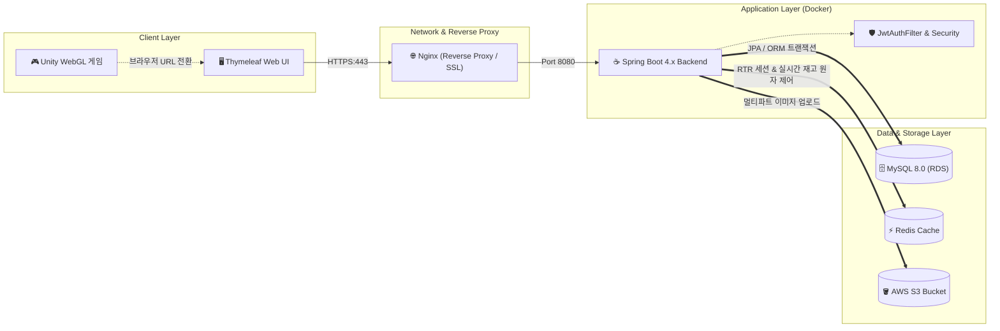
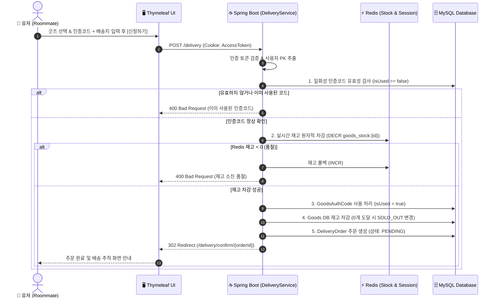
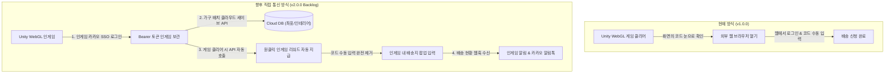

# 🛋️ Room Therapy (룸테라피)

> **힐링 3D 방 꾸미기 웹 게임과 실물 굿즈 리워드 배송 연동 플랫폼**
>
> 가상 공간에서의 테라피·힐링 경험을 현실의 실물 굿즈로 연결하는 스프링 부트 기반의 백엔드 시스템입니다.
>
> 🌐 **서비스 공식 접속 링크**: [https://www.roomtherapy.kr/](https://www.roomtherapy.kr/) 

---

## 📖 Chapter 1. 서비스 소개 및 사용자 경험 (Service Overview)

### 1.1 프로젝트 기획 배경
현대인들은 바쁜 일상 속에서 자신만의 공간을 꾸미고 휴식하며 힐링을 찾습니다.  
**Room Therapy(룸테라피)**는 웹 브라우저에서 가볍게 즐길 수 있는 **Unity WebGL 기반의 3D 방 꾸미기 게임**과 **현실의 실물 굿즈 리워드 배송 서비스**를 결합한 플랫폼입니다.

* **플레이**: 웹 브라우저에서 아늑한 3D 공간을 정리합니다.
* **보상**: 미션 클리어 후 획득한 보상으로 굿즈를 무료로 신청합니다.
* **일상으로의 확장**: 현실의 방에 배송된 굿즈를 통해 디지털 상의 힐링 경험이 실제 일상 공간으로 자연스럽게 이어집니다.

> 🎮 **(※ 게임 상세 소개 및 조작법은 유니티 담당자 검토 후 보강 예정)**
> * *주요 게임 요소*:  테마별 오브젝트 배치 및 정리, 하나씩 오브젝트를 클릭하여 정리하면 코인을 획득, 코인을 인증코드로 변경하여 굿즈 신청

---

### 1.2 핵심 사용자 여정 (User Journeys)

```mermaid
flowchart TD
    subgraph Roommate ["👤 일반 유저 (Roommate)"]
        A["🎮 Unity WebGL 게임 플레이"] -->|코인 획득| B["🔑 클리어 인증코드 획득"]
        B --> C["🟡 카카오 원클릭 로그인"]
        C --> D["🛍️ 굿즈 리워드 둘러보기"]
        D -->|인증코드 검증 & 배송지 입력| E["📦 굿즈 배송 신청 완료"]
        E --> F["🚚 마이페이지 배송 현황 추적"]
    end

    subgraph Seller ["🏷️ 굿즈 창작자/판매자 (Seller)"]
        S1["➕ 굿즈 등록 (S3 이미지 & 재고 & 인증코드)"] --> S2["📋 [내가 올린 굿즈] 전용 모아보기 / 실시간 재고 관리"]
        S2 --> S3["📦 [판매자 배송 관리] 본인 굿즈 주문 격리 조회"]
    end

    subgraph Admin ["👑 시스템 총괄 관리자 (Admin)"]
        AD1["🛡️ 전체 굿즈 통합 모니터링 / 수정 / 삭제"] --> AD2["📑 전체 배송 내역 관제 및 출고 최종 승인"]
    end
```



#### 1) 일반 룸메이트 (Roommate)
* **간편 로그인**: 별도 회원가입 없이 카카오 OAuth2를 통해 1초 만에 로그인합니다.
* **굿즈 리워드 샵**: 현재 신청 가능한 굿즈 목록, 실시간 재고/품절 상태, 상세 정보를 확인합니다.
* **배송 신청 & 코드 검증**: 게임 클리어 인증코드를 입력하여 실물 배송지를 접수합니다.
* **마이페이지**: 기본 배송지 설정, 실시간 배송 진행 현황(대기/승인/배송중/완료) 조회 및 배송지 변경을 지원합니다.

#### 2) 판매자 / 창작자 (Seller)
* **굿즈 및 인증코드 발행**: 신규 굿즈 등록(AWS S3 이미지 업로드, 재고 수량 설정) 및 게임과 연계할 인증코드를 대량 등록합니다.
* **내가 올린 굿즈 모아보기**: 둘러보기 페이지에서 `[내가 올린 굿즈]` 전용 필터를 통해 본인 등록 상품만 모아보고 실시간 재고를 수정합니다.
* **격리된 배송 내역 관리**: 자신이 등록한 굿즈에 대한 배송 신청 건만 안전하게 격리 조회하고 송장 번호를 입력합니다.

#### 3) 시스템 관리자 (Admin)
* **전체 거버넌스 관리**: 플랫폼 내 등록된 모든 굿즈와 전체 배송 신청 내역을 통합 관제하고 상태를 제어합니다.

---

### 1.3 디자인 시스템 (Design System)
전체 UI는 모듈화된 전역 디자인 토큰(`variables.css`)을 기반으로 일관된 룩앤필을 유지합니다.
* **Point Red (`#FF4B4E`)**: 브랜드 아이덴티티 및 주요 액션(신청하기, 활성 탭) 강조
* **Title (`#020202`)** / **Text (`#3C3C3C`)**: 편안한 가독성을 제공하는 명도 대비
* **Muted Gray (`#838383`)**: 보조 설명 및 카드 구분선 토큰

---

## ⚙️ Chapter 2. 기술 아키텍처 및 기술적 의사결정 (Technical Details)

### 2.1 기술 스택 (Tech Stack)

| 구분 | 기술 스택 | 상세 설명 |
| :--- | :--- | :--- |
| **Backend Core** | Java 17, Spring Boot 4.1.1 | 최신 스프링 부트 기반 백엔드 아키텍처 |
| **Security & Auth** | Spring Security, OAuth2 Client (Kakao), JJWT 0.12.5 | 카카오 소셜 인증 및 Stateless JWT / RTR 토큰 관리 |
| **Data & Cache** | Spring Data JPA, MySQL 8.0, Redis | 데이터 영속성 관리 및 실시간 재고·세션 토큰 인메모리 처리 |
| **Storage & Media** | AWS S3 (AWS SDK for Java v2) | 굿즈 썸네일/상세 이미지 고가용성 클라우드 스토리지 |
| **Infra & DevOps** | AWS EC2, Docker, Docker Compose, GitHub Actions | 컨테이너 기반 CI/CD 무중단 자동화 배포 파이프라인 |
| **Presentation** | Thymeleaf, HTML5/CSS3 (CSS Variables) | SEO와 서버사이드 렌더링(SSR)을 결합한 반응형 웹 뷰 |

---

### 2.2 시스템 아키텍처 다이어그램 (Architecture)

#### 1) 전체 시스템 인프라 아키텍처


#### 2) 리워드 배송 신청 & 실시간 재고 차감 시퀀스


---

### 2.3 현 상황 분석 및 기술적 의사결정 (Technical Decision Record)

> 💡 **핵심 상황: Unity WebGL 클라이언트와 백엔드 서버 간의 직접적인 인게임 실시간 통신 파이프라인이 아직 구축되지 않은 환경**  
> 현재 버전(v1.0.0)은 Unity 게임 엔진과 스프링 백엔드가 별도의 독립된 환경으로 구동되며, 게임 내 버튼 클릭 시 외부 웹 브라우저로 전환되는 구조입니다.  
> 이러한 제약 조건 속에서 **데이터 무결성, 보안, 사용자 편의성**을 확보하기 위해 다음과 같은 기술적 의사결정을 내렸습니다.

#### 1) 🎟️ 게임 클리어 검증: 일회성 인증코드(`GoodsAuthCode`) 아키텍처
* **문제 상황**: 인게임에서 백엔드 API를 직접 호출하여 "클리어 이벤트"를 서버로 전달하지 못하므로, 유저가 게임을 실제로 클리어했는지 웹에서 신뢰성 있게 검증할 수단이 필요했습니다.
* **의사결정**:
  * 판매자/관리자가 굿즈 등록 시 난수 기반의 `GoodsAuthCode`를 사전 대량 등록합니다.
  * 게임 내 미션 달성 화면에 특정 코드를 노출하고, 유저는 배송 신청 화면에서 해당 코드를 입력합니다.
  * 배송 신청 트랜잭션 내에서 **`isUsed = true` 원자적 검증 및 1회성 소모 처리**를 수행하여, 동일 코드의 중복 신청 및 어뷰징을 원천 차단했습니다.

#### 2) 🍪 하이브리드 인증 아키텍처 (쿠키 + Bearer 헤더 이중 지원)
* **문제 상황**: 현재는 WebGL에서 외부 브라우저 창으로 링크 이동하지만, 향후 Unity WebGL 인게임에서 직접 `UnityWebRequest`를 호출하는 구조로 발전해야 합니다.
* **의사결정**:
  * **웹 브라우저 접근 시**: 카카오 로그인 성공 시 발급되는 JWT를 `HttpOnly, Secure Cookie`에 안전하게 바인딩하여 XSS 공격을 방어하고 유저가 별도의 토큰 복사 없이 자연스러운 웹 서핑을 즐길 수 있도록 지원합니다.
  * **API 직접 호출 시**: `JwtAuthenticationFilter`가 쿠키뿐만 아니라 `Authorization: Bearer <token>` 헤더도 동시에 파싱하도록 설계하여, **클라이언트 환경의 변경 없이도 즉시 REST API 통신이 가능한 하이브리드 인증 체계**를 완성했습니다.

#### 3) ⚡ Redis 기반 RTR (Refresh Token Rotation) 및 실시간 재고 원자적 제어
* **보안 (RTR)**: Access Token(30분) 만료 시 Refresh Token(7일)으로 재발급할 때마다 기존 토큰을 폐기하고 신규 토큰으로 교체합니다. Redis에 저장된 토큰과 대조하여 **이미 사용된 옛 토큰이 인입될 경우 즉시 토큰 탈취로 감지하고 관련 세션을 즉시 무효화**합니다.
* **동시성 & 재고 연동**: 한정 수량 굿즈 신청 시 DB Lock 충돌을 완화하기 위해 Redis 인메모리 카운터와 DB 재고를 동기화하며, 재고 수량이 0에 도달하면 자동으로 `SOLD_OUT` 상태로 전환하여 품절 굿즈의 추가 신청을 즉시 차단합니다.

#### 4) 🛡️ SpEL 기반 선언적 리소스 권한 제어 (`@PreAuthorize`)
* Controller 레벨에서 Spring Expression Language(SpEL)를 활용해 소유자 PK를 동적으로 비교합니다.
  ```java
  // 판매자 본인의 굿즈이거나 관리자인 경우만 수정/삭제 허용
  @PreAuthorize("hasRole('ADMIN') or @goodsService.isOwner(#goodsId, principal.userId)")
  
  // 본인의 배송 주문이거나 관리자인 경우만 배송지 열람/수정 허용
  @PreAuthorize("hasRole('ADMIN') or @deliveryOrderService.isOrderOwner(#orderId, principal.userId)")
  ```
* 비인가 접근 시 `AccessDeniedException`을 전역 예외 처리기에서 가로채 **403 Forbidden** 표준 응답을 반환함으로써 타인 리소스에 대한 정보 유출 및 위변조를 방지했습니다.

---

### 2.4 추후 유니티 직접 통신 시 변경/도입 사항 (Future Roadmap & Backlog)

> 🚀 **향후 Unity WebGL 엔진과 Spring Boot 백엔드 간 직접 REST API / WebSocket 파이프라인 연동 시 전환될 백로그 과제**



| 구분 | 현재 구현 방식 (v1.0.0) | 유니티 직접 통신 시 개선 사항 (Backlog) |
| :--- | :--- | :--- |
| **리워드 획득 검증** | 화면에 표시된 `GoodsAuthCode`를 유저가 웹 폼에 **수동 복사/입력**하여 검증 | 게임 클리어 즉시 인게임에서 `/api/v1/game/clear`를 비동기 호출하여 **원클릭 자동 리워드 지급** (수동 입력 절차 완전 제거) |
| **로그인 & 세션 연동** | 웹 브라우저 기반 카카오 OAuth2 리다이렉트 및 브라우저 쿠키 인증 | Unity WebGL 내 카카오 로그인 팝업 연동 및 **인게임 Single Sign-On (SSO)** 환경 구축 |
| **방 꾸미기 데이터 영속화**| 브라우저 LocalStorage 또는 Unity 로컬 PlayerPrefs에 저장 | **클라우드 세이브 API 구축**: 가구 오브젝트 배치 좌표, 인테리어 메타데이터를 백엔드 DB에 유저별로 영구 저장 및 불러오기 |
| **배송 상태 피드백** | 유저가 마이페이지 배송 탭에 직접 접속하여 상태 조회 | 배송 승인/출고 시 **카카오 알림톡 발송** 및 Unity 인게임 실시간 푸시 팝업 안내 |

---

## 🚀 로컬 개발 환경 가이드 (Getting Started)

### 1. 필수 사전 준비
* Java 17 (Temurin / Corretto 권장)
* Docker & Docker Compose (Redis 실행용)

### 2. Redis 인메모리 컨테이너 구동
```bash
docker run -d -p 6379:6379 --name roomtherapy-redis redis:alpine
```

### 3. 환경 변수 설정 (`application-secret.yml`)
`src/main/resources/application-secret.yml` 생성 (Git 추적 제외):
```yaml
spring:
  security:
    oauth2:
      client:
        registration:
          kakao:
            client-id: ${KAKAO_CLIENT_ID:YOUR_REST_API_KEY}
            client-secret: ${KAKAO_CLIENT_SECRET:YOUR_CLIENT_SECRET}

jwt:
  secret: ${JWT_SECRET:YOUR_BASE64_ENCODED_256BIT_KEY}

cloud:
  aws:
    credentials:
      access-key: ${AWS_ACCESS_KEY_ID:YOUR_AWS_KEY}
      secret-key: ${AWS_SECRET_ACCESS_KEY:YOUR_AWS_SECRET}
    s3:
      bucket: ${AWS_S3_BUCKET_NAME:YOUR_BUCKET}
    region:
      static: ${AWS_REGION:ap-northeast-2}
```

### 4. 로컬 빌드 및 서버 구동
```bash
./gradlew bootRun
```
* 서버 실행 후 브라우저에서 `http://localhost:8080` 접속
* H2 Database 콘솔: `http://localhost:8080/h2-console` (JDBC URL: `jdbc:h2:mem:roomtherapy`)
* Swagger UI 명세서: `http://localhost:8080/swagger-ui.html`
