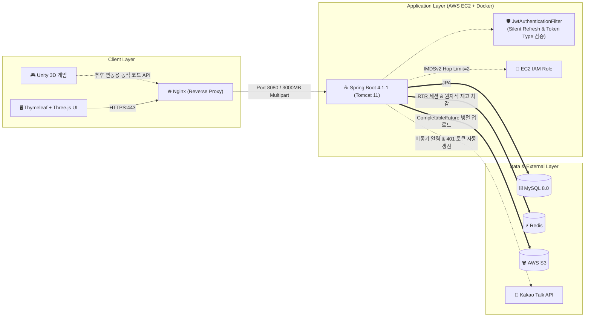
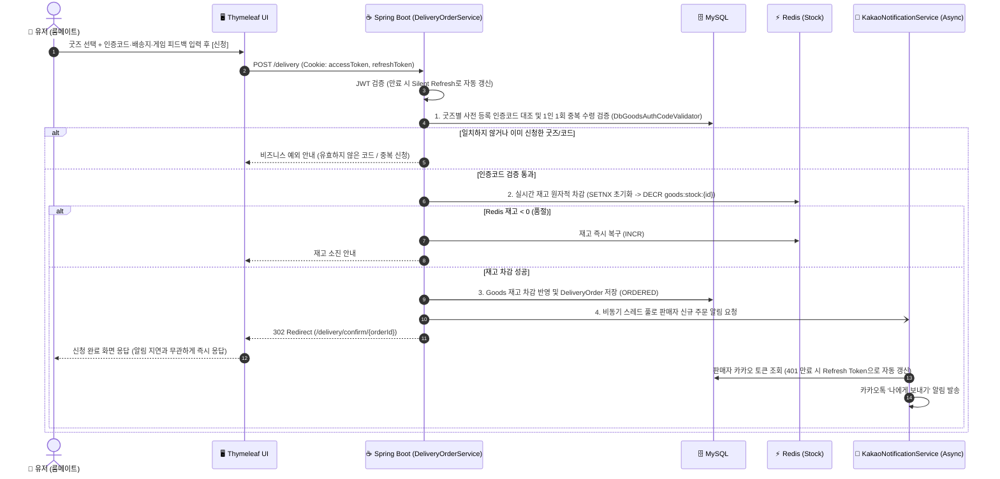

# 🛋️ Room Therapy (룸테라피)

> **3D 방 정리 웹 게임 · 웹 3D 오브제 전시관 · 실물 굿즈 리워드 배송 연동 플랫폼**
>
> 게임 플레이 경험을 웹 브라우저 내 3D 전시관과 실물 굿즈 우편 배송으로 연결하는 Spring Boot 기반 웹 서비스입니다.
>
> 🌐 **서비스 접속 링크**: [https://www.roomtherapy.kr/](https://www.roomtherapy.kr/)
> <br>📄 **API 명세 (Swagger UI)**: 로컬 구동 시 `http://localhost:8080/swagger-ui.html` *(운영 `prod` 환경에서는 비활성화)*

---

## 🎬 시연 영상 (Demo Videos)

### Vision Pro (`visionOS`) Immersive Space 웹앱 시연 영상

[](https://www.youtube.com/watch?v=2AJzwDxC_K8)

### iPhone 시연 쇼츠

[](https://youtube.com/shorts/pWtC9NGGphw)

---

## 📖 Chapter 1. 서비스 소개 및 주요 기능

### 1.1 프로젝트 소개
**Room Therapy(룸테라피)**는 **Unity 기반 3D 방 정리 게임**, 웹 브라우저에서 오브제를 둘러보는 **Three.js 3D 전시관**, 
그리고 스테이지 클리어 보상으로 실제 굿즈를 받아볼 수 있는 **리워드 배송 신청 시스템**을 하나로 묶은 프로젝트입니다.


* **게임 플레이 & 코드 획득**: 3D 방 정리 스테이지를 클리어하고 1회성 인증코드를 발급받습니다.
* **3D 오브제 전시관**: 웹 브라우저의 **Three.js 기반 3D 전시관**에서 스테이지에 등장하는 3D 오브제(`.glb`, `.fbx`, `.obj`, `.usdz`)들을 360도로 돌려보고 확대하며 감상할 수 있습니다 (`visionOS` Safari 및 모바일 웹 대응).
* **실물 굿즈 신청 & 피드백**: 클리어 인증코드로 원하는 리워드 굿즈를 무료 신청하고 게임 피드백을 남기면, 담당 창작자(판매자)에게 실시간 카카오톡 알림이 전달되어 일반우편으로 굿즈가 발송됩니다.

---

### 1.2 사용자 흐름 (User Flows)

```mermaid
flowchart TD
    subgraph Roommate ["👤 일반 유저 (룸메이트)"]
        A["🎮 Unity 3D 게임 플레이"] -->|스테이지 클리어 코드 확인| B["🔑 인증코드 획득"]
        B --> C["🟡 카카오 로그인"]
        C --> D["🛍️ 굿즈 목록 & Three.js 3D 전시관 감상"]
        D -->|인증코드 검증 · 배송지 및 게임 피드백 입력| E["📦 굿즈 배송 신청 완료"]
        E --> F["🚚 마이페이지 배송 현황 조회 & 배송지 수정"]
    end

    subgraph Seller ["🏷️ 굿즈 담당자 / 판매자 (Seller)"]
        S1["➕ 굿즈 · 3D 오브제 · 인증코드 관리<br/>(S3 병렬 업로드 / 엑셀·ZIP 일괄 등록)"] --> S2["💬 신규 신청 · 배송지 변경 시<br/>실시간 카카오톡 알림 수신"]
        S2 --> S3["📦 본인 굿즈 주문/피드백 모아보기<br/>& 조건별 엑셀(.xlsx) 다운로드"]
    end

    subgraph Admin ["👑 관리자 (Admin)"]
        AD1["🛡️ 전체 굿즈 · 인증코드 통합 관리"] --> AD2["📑 전체 배송 신청/피드백 조회 & 엑셀 일괄 처리"]
    end
```



#### 1) 일반 유저 (룸메이트)
* **카카오 로그인 & 세션 유지**: 카카오 OAuth2로 간편하게 로그인하며, **서버 사이드 Silent Refresh**를 통해 이용 도중 Access Token이 만료되더라도 끊김 없이 세션을 이어갑니다.
* **웹 3D 전시관**: 각 굿즈에 등록된 3D 오브제들을 썸네일 카드로 먼저 확인하고, 선택한 오브제만 **온디맨드 지연 로딩(Lazy Loading)** 및 **인메모리 캐싱**으로 불러와 무거운 3D 모델도 쾌적하게 감상합니다.
* **굿즈 배송 신청 & 게임 피드백**: 인증코드 유효성을 사전 검증한 뒤 배송지를 입력해 굿즈를 신청하며, 선택적으로 게임 플레이 피드백을 함께 남길 수 있습니다.
* **마이페이지**: 기본 배송지 저장, 신청 내역 및 진행 상태(`접수 완료` / `배송 준비중` / `발송 완료` / `배송 완료`) 확인, 발송 전 배송지 수정을 지원합니다.

#### 2) 판매자 / 굿즈 담당자 (Seller) *(실제로는 무료 리워드 발송이나 시스템 권한상 판매자로 표기)*
* **3D 오브제 & 이미지 관리**: 다수의 굿즈 사진과 대용량 3D 오브제 파일(개별 최대 300MB, 총합 3,000MB), 커스텀 썸네일을 드래그 앤 드롭으로 등록하고 노출 순서를 조정(▲/▼)하며 파일별 용량을 실시간으로 확인합니다.
* **굿즈별 인증코드 & 일괄 등록**: 굿즈마다 클리어 인증코드를 개별 생성·복사·삭제하거나, 엑셀(`.xlsx`) 및 `.zip` 압축 파일로 굿즈와 주문 내역을 일괄 등록할 수 있습니다.
* **실시간 카카오톡 알림 수신**: 유저가 내 굿즈를 새로 신청하거나 배송지(주소·수령인)를 수정하면 카카오톡으로 즉시 알림을 받으며, 알림 내 바로가기 버튼으로 대시보드에 바로 접근할 수 있습니다.
* **주문·피드백 관리 & 엑셀 다운로드**: 본인 굿즈의 주문 내역만 분리 조회하며, **`사용자가 수정한 주문`** 탭과 **`피드백 모아보기`** 탭으로 필요한 내역만 필터링하거나 조건별 엑셀(`.xlsx`) 파일로 다운로드합니다.

#### 3) 시스템 관리자 (Admin)
* **전체 굿즈 및 배송 통합 관리**: 환경변수(`ADMIN_KAKAO_IDS`, `SELLER_KAKAO_IDS`) 기반 권한 동기화를 통해 운영진을 지정하고, 플랫폼 내 전체 굿즈·인증코드·배송 신청 및 유저 피드백을 통합 관리합니다.

---

### 1.3 프론트엔드 구조 및 스타일
뷰 템플릿 내 인라인 스타일과 스크립트를 걷어내고, 공통 디자인 변수(`variables.css`)와 화면별 정적 모듈(`landing`, `goods-list`, `goods-exhibition`, `seller-goods-form`, `goods-codes`, `deliveries`, `mypage`, `user-delivery`, `error`)로 분리해 관리합니다.

---

## ⚙️ Chapter 2. 기술 스택 및 아키텍처

### 2.1 기술 스택 (Tech Stack)

| 구분 | 기술 스택 | 비고 |
| :--- | :--- | :--- |
| **Backend** | Java 17, Spring Boot 4.1.1 (Tomcat 11), Spring Data JPA | 도메인별 패키지 구조 및 트랜잭션 관리 |
| **Security & Auth** | Spring Security, OAuth2 Client (Kakao), JJWT 0.12.5 | 카카오 로그인(`talk_message` 동적 동의 포함), JWT(`ACCESS`/`REFRESH`), RTR 및 서버 사이드 Silent Refresh |
| **Database & Cache** | MySQL 8.0, H2 (Local/Test), Redis | RDB 영속성 관리, Redis 원자적 재고 차감(`DECR`/`SETNX`) 및 동적 코드 소진(`DEL` · 추후 연동 대비) |
| **External & Async** | Kakao Talk Memo API, AWS S3 (SDK v2), `CompletableFuture` | 비동기 스레드 풀 기반 실시간 카톡 알림(토큰 자동 갱신) 및 S3 멀티파트 병렬 업로드 |
| **3D & Office** | Three.js (WebGL), Apache POI, `ZipInputStream` | 다중 포맷(`.glb/.fbx/.obj/.usdz`) 3D 전시관, 주문/피드백 엑셀 입출력 및 ZIP 일괄 등록 |
| **Infra & CI/CD** | AWS EC2 (IAM Role / IMDSv2), Nginx, Docker, GitHub Actions | IAM Role 기반 무키(Keyless) S3 인증, 리버스 프록시 스트리밍 및 자동 배포 파이프라인 |
| **Frontend** | Thymeleaf, Vanilla JS (ES6+), CSS3 | SSR 웹 뷰, `DataTransfer` API 기반 다중 파일 순서 제어 및 라이트박스/모달 UI |

---

### 2.2 시스템 아키텍처 다이어그램

#### 1) 전체 시스템 구조


#### 2) 굿즈 배송 신청 · 동시성 제어 · 실시간 카톡 알림 흐름


---

### 2.3 주요 기술적 의사결정 및 트러블슈팅

#### 1) ⚡ Redis 원자적 재고 차감 및 전략 패턴 기반 인증코드 검증 (정적 DB 운영 & 동적 Redis 사전 구현)
* **배경**: 한정 수량 굿즈 신청 시 동시 요청이 몰릴 때 재고가 음수로 내려가는 경합 문제를 막아야 했고, 인증코드 검증 방식 또한 현재의 유니티 배포 환경(정적 코드)과 추후 API 연동 환경(동적 1회성 코드)을 모두 고려해야 했습니다.
* **해결 방식**:
  * **실시간 재고 차감 (`RedisGoodsStockService` · 현재 운영 적용)**: 무거운 분산 락(`RLock`) 대신 Redis 싱글 스레드의 단일 원자적 명령어를 사용했습니다. 캐시 미스 시 `setIfAbsent`(`SETNX`)로 초기 재고를 세팅해 덮어쓰기 경합을 막고, `decrement`(`DECR`) 결과값이 `0` 미만일 때만 `increment`(`INCR`)로 즉시 복구합니다.
  * **전략 패턴 기반 인증코드 검증 (`GoodsAuthCodeValidator`)**:
    * **1차 방식 (`DbGoodsAuthCodeValidator` · 현재 운영 중)**: 현재는 유니티 웹 빌드와 백엔드 배포 주기를 분리하기 위해, 유니티 스테이지에 설정된 클리어 코드를 판매자가 굿즈 등록 시 함께 입력해 두고 DB에서 대조합니다. 동일 유저의 중복 신청은 `existsByUserIdAndGoodsId` 및 `existsByUserIdAndStageCode`로 차단합니다.
    * **2차 방식 (`RedisGoodsAuthCodeValidator` · 추후 유니티 API 직접 연동 대비 사전 구현)**: 향후 유니티 클라이언트에서 클리어 시점에 서버 API(`POST /api/unity/goods/{goodsId}/issue-code`)를 호출해 유저별 1회성 동적 코드를 발급받는 방식으로 전환할 예정입니다. 이때 주문 서비스(`DeliveryOrderService`) 코드를 수정하지 않고 바로 전환할 수 있도록, Redis TTL 저장 및 `Boolean.TRUE.equals(redisTemplate.delete(key))` 기반의 원자적 1회 소진 검증기를 미리 구현해 두었습니다.

#### 2) 💬 비동기 카카오톡 알림 격리, 토큰 자동 갱신 및 동적 추가 동의
* **배경**: 유저가 굿즈를 신청하거나 배송지를 수정했을 때 담당 판매자가 이를 바로 알 수 있어야 했지만, 외부 카카오 API 호출 지연이나 장애가 유저의 배송 신청 트랜잭션에 영향을 주어서는 안 됐습니다. 또한 리워드가 송장 추적이 안 되는 **일반우편**으로 발송되므로, 수령인에게 불필요한 도착 불안감이나 문의를 유발할 수 있는 발송 알림은 빼고 **판매자 운영 알림(신규 신청 / 배송지 수정)** 2종에 집중했습니다.
* **해결 방식**:
  * **비동기 스레드 풀 & 예외 격리 (`KakaoNotificationService`)**: 전용 스레드 풀(`kakao-notification-worker`)에서 비동기로 알림을 발송하고 내부에서 예외를 격리해, 카카오 API가 실패하더라도 주문 생성·수정은 정상 완료되도록 구성했습니다.
  * **배송지 수정 변경점 표시**: 배송지 수정 알림 시 이전 값과 비교하여 실제로 바뀐 항목 옆에만 `(변경)` 태그를 붙여 판매자가 우편 봉투 작성 전 바뀐 정보를 바로 알아볼 수 있게 했습니다.
  * **토큰 자동 갱신 & 동적 재동의 (`OAuth2SuccessHandler`, `SecurityConfig`)**: 카톡 발송 시 Access Token이 만료(`401`)되었으면 DB에 저장된 Refresh Token으로 자동 재발급받아 재시도합니다. 기존에 `talk_message` 권한 없이 가입했던 판매자/관리자가 로그인하면 이를 감지해 추가 동의 화면(`?reconsent=talk_message`)으로 1회 자동 연결합니다.

#### 3) 🛡️ 서버 사이드 Silent Refresh, 토큰 타입(`type`) 분리 및 접근 제어
* **서버 사이드 Silent Refresh (`JwtAuthenticationFilter`)**: 판매자가 3D 오브제 여러 개를 오랜 시간 편집하다가 제출할 때 Access Token(30분)이 만료되어 작업 내용이 날아가는 문제를 막기 위해, 필터에서 만료된 Access Token과 유효한 Refresh Token(7일)을 함께 감지하면 즉시 새 토큰 쌍을 재발급(RTR)해 쿠키를 교체하고 요청을 그대로 통과시킵니다.
* **토큰 타입 교차 검증 (`JwtProvider`)**: Refresh Token을 일반 API의 Access Token처럼 끼워 넣는 시도를 막기 위해 JWT Claim에 `type: "ACCESS"` / `"REFRESH"`를 명시해 구분 검증합니다.
* **리소스 소유권 및 상태 검증**: `@PreAuthorize`와 SpEL(`@deliveryOrderService.isOrderOwner`)로 타인의 주문 조회/수정을 차단하고, 이미 발송 완료(`SHIPPED`)된 주문은 URL 직접 입력(`GET /delivery/edit/{id}`)으로 수정 폼에 접근하지 못하도록 서버 단에서 함께 검증합니다.

#### 4) 🎨 대용량 Three.js 웹 3D 전시관 & S3 병렬 업로드
* **지연 로딩 & 메쉬 캐싱 (`goods-exhibition.js`)**: 전시관 진입 시 수백 MB의 3D 파일을 한 번에 받지 않고 가벼운 썸네일만 먼저 보여준 뒤, 클릭한 오브제만 온디맨드로 로드합니다. 한 번 불러온 3D 모델은 메모리(`Map`)에 캐싱해 다시 클릭할 때 네트워크 재요청 없이 복제(`clone()`)해 띄웁니다.
* **무버퍼 스트리밍 (`GoodsController`)**: 모델 스트리밍 응답에 `X-Accel-Buffering: no` 헤더를 내려 Nginx가 대용량 3D 파일을 디스크에 쌓아두지 않고 브라우저로 바로 흘려보내도록 처리했습니다.
* **S3 병렬 업로드 (`S3StorageService`)**: `Executors.newFixedThreadPool(6)`과 `CompletableFuture`를 사용해 다수의 3D 모델과 이미지를 S3에 병렬로 업로드합니다.

#### 5) 🏢 멀티파트 3계층(Nginx - Tomcat 11 - Spring) 튜닝 및 브라우저 캐시 CORS 트러블슈팅
* **Tomcat 11 `maxPartCount=50` 제한 해결**: 3D 오브제를 9개 이상 등록할 때(기본 입력 필드 + 오브제별 5개 필드 = 50개 초과) 내장 Tomcat 11의 기본 파트 개수 제한(`maxPartCount = 50`)에 걸려 `413 Payload Too Large`가 발생하던 원인을 찾아 `max-part-count: 1000`, `max-part-header-size: 16KB`, `max-swallow-size: -1`로 조정했습니다.
* **브라우저 `` 캐시로 인한 CORS 차단 우회 (`seller-goods-form.js`)**: 수정 화면의 `` 태그가 `no-cors`로 먼저 캐싱해 둔 S3 응답 때문에, 직후 파일 용량 표시를 위해 실행한 JS `fetch(url, { method: 'HEAD' })`가 CORS 에러로 막히던 문제를 `cache: 'no-store'` 옵션으로 해결했습니다.

#### 6) 🔒 클라우드 및 파일/웹 보안 처리
* **EC2 IAM Role & IMDSv2 Hop Limit 설정**: 서버 환경변수에 AWS Access Key를 두지 않고 EC2 IAM Role을 연결했으며, Docker 컨테이너 브리지 네트워크에서 메타데이터 조회가 막히지 않도록 IMDSv2 `http-put-response-hop-limit = 2`로 구성했습니다.
* **엑셀 수식 인젝션 & ZIP 압축 폭탄 방어**: 엑셀 다운로드 시 `=`, `+`, `-`, `@`로 시작하는 값 앞에 `'`를 붙여 수식 실행을 막고, ZIP 일괄 등록 시 경로 조작(`..`) 차단 및 단일 파일(20MB)·총합(100MB)·파일 수(200개) 제한을 두어 OOM을 방지했습니다.

---

## 🚀 로컬 개발 환경 실행 방법

### 1. 사전 준비
* Java 17
* Docker (로컬 Redis 실행용)

### 2. Redis 컨테이너 실행
```bash
docker run -d -p 6379:6379 --name roomtherapy-redis redis:alpine
```

### 3. 환경 변수 설정 (`application-secret.yml`)
로컬(`local` 프로파일)에서는 `LocalStorageService`가 동작하므로 AWS S3 설정 없이도 이미지·3D 오브제 업로드를 바로 테스트할 수 있습니다.

`src/main/resources/application-secret.yml` 예시 (Git 추적 제외):
```yaml
spring:
  security:
    oauth2:
      client:
        registration:
          kakao:
            client-id: ${KAKAO_CLIENT_ID:YOUR_REST_API_KEY}
            client-secret: ${KAKAO_CLIENT_SECRET:YOUR_CLIENT_SECRET}

jwt:
  secret: ${JWT_SECRET:YOUR_BASE64_ENCODED_256BIT_KEY}
```

### 4. 서버 실행
```bash
./gradlew bootRun
```
* 웹 서비스: `http://localhost:8080`
* H2 콘솔: `http://localhost:8080/h2-console` (JDBC URL: `jdbc:h2:mem:roomtherapy`)
* Swagger UI (로컬 전용): `http://localhost:8080/swagger-ui.html`
