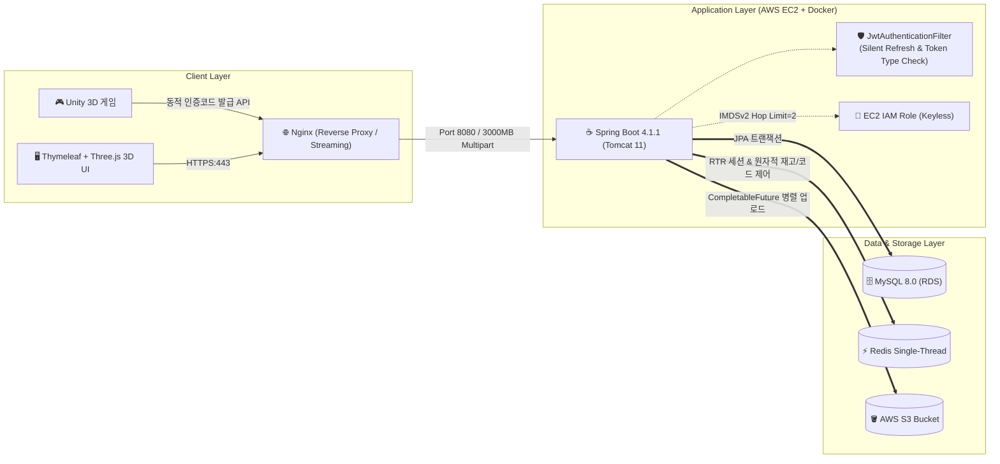
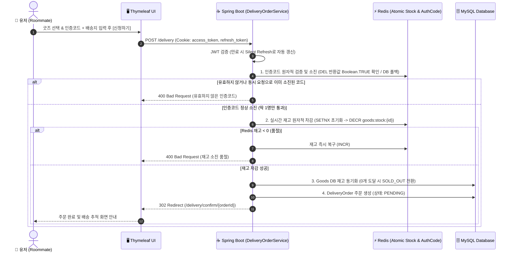

[](https://www.youtube.com/watch?v=2AJzwDxC_K8)

# 🛋️ Room Therapy (룸테라피)

> **힐링 3D 방 정리 웹 게임과 웹 3D 인터랙티브 전시관 & 실물 굿즈 리워드 배송 연동 플랫폼**
>
> 가상 공간에서의 테라피·힐링 경험을 웹 3D 오브제 전시관과 현실의 실물 굿즈로 연결하는 스프링 부트 기반의 백엔드·웹 시스템입니다.
>
> 🌐 **서비스 공식 접속 링크**: [https://www.roomtherapy.kr/](https://www.roomtherapy.kr/)
> <br>📄 **API 명세 (Swagger UI)**: 로컬 구동 시 `http://localhost:8080/swagger-ui.html` *(※ 운영 `prod` 환경에서는 API 명세 노출 방지를 위해 보안상 비활성화되어 있습니다.)*

---

## 📖 Chapter 1. 서비스 소개 및 사용자 경험 (Service Overview)

### 1.1 프로젝트 기획 배경
현대인들은 바쁜 일상 속에서 자신만의 공간을 꾸미고 정리하고 휴식하며 힐링을 찾습니다.  
**Room Therapy(룸테라피)**는 웹 브라우저에서 가볍게 즐길 수 있는 **Unity 기반의 3D 방 정리 게임**, 웹에서 오브제를 360도로 감상하는 **Three.js 3D 인터랙티브 전시관**, 그리고 **현실의 실물 굿즈 리워드 배송 서비스**를 결합한 플랫폼입니다.

* **플레이**: 아늑한 3D 공간을 정리하며 미션을 클리어하고 1회성 인증코드를 획득합니다.
* **감상 (3D 전시관)**: 웹 브라우저 내 **Three.js 기반 3D 전시관**에서 방 안의 3D 오브제(`.glb`, `.fbx`, `.obj`, `.usdz`)들을 360도로 회전·확대하며 생생하게 감상합니다.
* **보상 & 일상으로의 확장**: 클리어 인증코드로 실물 굿즈를 무료 신청하고, 현실의 방에 배송된 굿즈를 통해 디지털 상의 힐링 경험이 실제 일상 공간으로 자연스럽게 이어집니다.

---

### 1.2 핵심 사용자 여정 (User Journeys)

```mermaid
flowchart TD
    subgraph Roommate ["👤 일반 유저 (Roommate)"]
        A["🎮 Unity 3D 게임 플레이"] -->|클리어 코드 발급| B["🔑 1회성 인증코드 획득"]
        B --> C["🟡 카카오 원클릭 로그인"]
        C --> D["🛍️ 굿즈 샵 & Three.js 3D 전시관 감상"]
        D -->|인증코드 검증 & 배송지 입력| E["📦 굿즈 배송 신청 완료"]
        E --> F["🚚 마이페이지 실시간 배송 현황 추적"]
    end

    subgraph Seller ["🏷️ 굿즈 창작자/판매자 (Seller)"]
        S1["➕ 굿즈 & 대용량 3D 오브제 등록<br/>(S3 병렬 업로드 / ZIP 일괄 등록)"] --> S2["📋 [내가 올린 굿즈] 모아보기<br/>& 다중 파일 순서/용량 실시간 관리"]
        S2 --> S3["📦 본인 굿즈 주문 격리 조회<br/>& 다차원 필터 엑셀(.xlsx) 다운로드"]
    end

    subgraph Admin ["👑 시스템 총괄 관리자 (Admin)"]
        AD1["🛡️ 전체 굿즈 통합 모니터링 & 회원 권한(Role) 관리"] --> AD2["📑 전체 배송 내역 관제, 출고 승인 & 통합 엑셀 다운로드"]
    end
```



#### 1) 일반 룸메이트 (Roommate)
* **간편 로그인 & 무중단 세션**: 별도 회원가입 없이 카카오 OAuth2로 1초 만에 로그인하며, **서버 사이드 Silent Refresh**를 통해 활동 중 세션이 끊기지 않습니다.
* **웹 3D 인터랙티브 전시관**: 각 굿즈에 등록된 여러 3D 오브제를 썸네일 카드로 탐색하고, 클릭 시 **온디맨드 지연 로딩(Lazy Loading)** 및 **인메모리 캐싱**을 통해 수백 MB 규모의 전시관을 끊김 없이 감상합니다.
* **배송 신청 & 실시간 코드 검증**: 게임 클리어 인증코드를 입력하여 유효성을 실시간 검증받고 실물 배송지를 접수합니다.
* **마이페이지**: 기본 배송지 설정, 실시간 배송 진행 현황(대기/승인/배송중/완료) 조회 및 배송지 변경을 지원합니다.

#### 2) 판매자 / 창작자 (Seller)
* **대용량 3D 오브제 & 이미지 관리**: 다수의 굿즈 사진과 3D 오브제 모델(개별 최대 300MB, 총합 3,000MB) 및 커스텀 썸네일을 드래그 앤 드롭으로 등록하고, 순서를 자유롭게 변경(▲/▼)하며 기존 S3 파일과 신규 파일의 용량을 실시간 배지로 확인합니다.
* **ZIP 대량 일괄 등록**: 엑셀 메타데이터(`.xlsx`)와 다수의 상품 이미지를 하나의 `.zip` 압축 파일로 업로드하여 여러 굿즈를 한 번에 등록합니다.
* **격리된 배송 내역 관리 & 엑셀 다운로드**: 자신이 등록한 굿즈의 배송 신청 건만 안전하게 격리 조회하여 송장 번호를 입력하고, 배송 상태·굿즈·검색어별로 필터링된 주문 내역을 **`.xlsx` 엑셀 파일로 즉시 다운로드**합니다.

#### 3) 시스템 관리자 (Admin)
* **전체 거버넌스 & 권한 관리**: 플랫폼 내 모든 회원의 권한(`ROLE_USER`, `ROLE_SELLER`, `ROLE_ADMIN`)을 실시간 제어하고, 전체 굿즈 및 배송 신청 내역을 통합 관제합니다.

---

### 1.3 디자인 시스템 & 프론트엔드 모듈 아키텍처
전체 UI는 전역 디자인 토큰(`variables.css`)과 도메인별로 분리된 CSS/JS 모듈 구조를 기반으로 일관된 룩앤필과 높은 유지보수성을 유지합니다.
* **Point Red (`#FF4B4E`)**: 브랜드 아이덴티티 및 주요 액션(신청하기, 활성 탭, 용량 배지) 강조
* **Title (`#020202`)** / **Text (`#3C3C3C`)** / **Muted Gray (`#838383`)**: 높은 가독성을 제공하는 명도 대비 시스템
* **도메인별 정적 리소스 모듈화**: `landing`, `goods-list`, `goods-exhibition`, `seller-goods-form`, `deliveries`, `mypage`, `error` 등 뷰 템플릿 내 인라인 스타일·스크립트를 제거하고 독립 모듈로 관리

---

## ⚙️ Chapter 2. 기술 아키텍처 및 기술적 의사결정 (Technical Details)

### 2.1 기술 스택 (Tech Stack)

| 구분 | 기술 스택 | 상세 설명 |
| :--- | :--- | :--- |
| **Backend Core** | Java 17, Spring Boot 4.1.1 (Tomcat 11) | 최신 스프링 부트 기반 엔터프라이즈 백엔드 아키텍처 |
| **Security & Auth** | Spring Security, OAuth2 Client (Kakao), JJWT 0.12.5 | 카카오 소셜 인증, 토큰 타입(`ACCESS`/`REFRESH`) 분리, RTR 회전 및 서버 사이드 Silent Refresh |
| **Data & Concurrency** | Spring Data JPA, MySQL 8.0, Redis | 데이터 영속성 관리, Lock-Free 실시간 재고 원자적 차감(`DECR`/`SETNX`) 및 1회성 코드 CAS 소진(`DEL`) |
| **Storage & Media** | AWS S3 (SDK v2), `CompletableFuture` | `@Profile` 기반 스토리지 추상화(`Local`/`S3`) 및 멀티스레드 풀 기반 대용량 3D 파일 병렬 업로드 |
| **3D & Office Processing** | Three.js (WebGL), Apache POI, `ZipInputStream` | 다중 포맷(`.glb/.fbx/.obj/.usdz`) 웹 3D 전시관 렌더링, 배송 내역 엑셀 다운로드 및 ZIP 대량 등록 |
| **Infra & Cloud Security** | AWS EC2 (IAM Role / IMDSv2), Nginx, Docker, GitHub Actions | 무키(Keyless) IAM Role 보안 인증, 리버스 프록시 무버퍼 스트리밍 및 CI/CD 자동화 배포 |
| **Presentation** | Thymeleaf, Vanilla ES6+ (`DataTransfer` API), CSS3 | SSR 기반 반응형 웹 뷰, 읽기 전용 `FileList` 한계를 극복한 다중 파일 순서 동기화 |

---

### 2.2 시스템 아키텍처 다이어그램 (Architecture)

#### 1) 전체 시스템 인프라 아키텍처


#### 2) 리워드 배송 신청 & Redis 원자적 동시성 제어 시퀀스


---

### 2.3 핵심 기술적 의사결정 및 트러블슈팅 (Technical Decision Records)

#### 1) ⚡ 무거운 분산 락을 대체한 Redis 싱글 스레드 원자적 연산 (Lock-Free 동시성 제어)
* **배경**: 한정 수량 굿즈 신청과 1회성 인증코드 사용 시 발생하는 Race Condition(재고 초과 차감 및 '따닥' 중복 신청)을 막아야 했습니다.
* **의사결정**:
  * 락 획득/대기/반납 오버헤드가 발생하는 무거운 분산 락(`RLock`) 대신, **Redis 싱글 스레드 이벤트 루프의 단일 원자적 명령어(Atomic Command)**를 활용하여 스레드 대기 시간(Lock Wait) 0초로 경량화했습니다.
  * **재고 차감 (`RedisGoodsStockService`)**: `setIfAbsent`(`SETNX`)로 캐시 미스 시 초기값 덮어쓰기 경합을 방지하고, `decrement`(`DECR`)로 원자적 차감 후 음수(`remain < 0`)일 때만 `increment`(`INCR`)로 롤백합니다.
  * **1회성 코드 소진 (`RedisGoodsAuthCodeValidator` / `RedisDynamicStageCodeValidator`)**: 조회(`hasKey`)와 삭제(`delete`)를 분리하지 않고, **`Boolean.TRUE.equals(redisTemplate.delete(key))` 반환값을 검증하는 CAS(Compare-And-Swap) 패턴**으로 동시 요청 중 정확히 최초 1건만 통과시킵니다.

#### 2) 🔑 전략 패턴(`StageCodeValidator`) 기반 유니티 실시간 동적 인증코드 연동
* **의사결정**:
  * 고정 스테이지 코드(`SetBasedStageCodeValidator`), 유니티 인게임 실시간 발급 동적 코드(`RedisDynamicStageCodeValidator`, `POST /api/unity/goods/{goodsId}/issue-code`), 굿즈별 사전 등록 코드(`RedisGoodsAuthCodeValidator`)를 **`StageCodeValidator` 인터페이스로 추상화(Strategy Pattern)**하여 기획 변경이나 인증 수단 추가 시 기존 주문 로직 수정 없이 확장 가능하도록 설계했습니다.

#### 3) 🛡️ 서버 사이드 Silent Refresh, 토큰 타입(`type`) 분리 및 SpEL IDOR 방어
* **서버 사이드 Silent Refresh & RTR (`JwtAuthenticationFilter`)**: 판매자가 긴 시간 동안 3D 오브제를 세팅한 뒤 폼을 제출할 때 Access Token(30분)이 만료되어 작성 데이터가 유실되는 문제를 막기 위해, 백엔드 필터가 만료된 Access Token 감지 시 동봉된 Refresh Token(7일)으로 **즉시 새 토큰 세트를 재발급(RTR)하여 쿠키를 갱신하고 원래 요청을 중단 없이 통과**시킵니다.
* **토큰 교차 사용 차단 (`JwtProvider`)**: 탈취된 Refresh Token을 일반 API의 Access Token처럼 사용하는 공격(Token Type Confusion)을 막기 위해 JWT Claim에 `type: "ACCESS"`와 `type: "REFRESH"`를 명시하여 교차 검증합니다.
* **선언적 리소스 소유권 검증 (`@PreAuthorize`)**: `@PreAuthorize("hasRole('ADMIN') or @deliveryOrderService.isOrderOwner(#orderId, principal)")`를 통해 타인의 배송지 조회/수정을 원천 차단(IDOR 방어)했습니다.

#### 4) 🎨 대용량 Three.js 웹 3D 전시관 & S3 멀티스레드 병렬 파이프라인
* **커스텀 썸네일 지연 로딩 & 인메모리 캐싱 (`goods-exhibition.js`)**: 전시관 진입 시 수백 MB의 3D 모델들을 한꺼번에 받지 않고 가벼운 썸네일 카드만 먼저 렌더링한 뒤, 유저가 클릭한 오브제만 온디맨드로 로드합니다. 한 번 파싱된 Three.js 메쉬는 `modelTemplateCache`(`Map`)에 보관하여 재선택 시 네트워크 요청 없이 즉시 복제(`clone()`)합니다.
* **무버퍼 스트리밍 프록시 (`GoodsController`)**: 백엔드 모델 스트리밍 엔드포인트에 `X-Accel-Buffering: no` 헤더를 적용하여 Nginx가 대용량 3D 파일을 디스크에 버퍼링하지 않고 즉시 브라우저로 스트리밍하도록 최적화했습니다.
* **멀티스레드 S3 병렬 업로드 (`S3StorageService`)**: 전용 스레드 풀(`Executors.newFixedThreadPool(6)`)과 `CompletableFuture.supplyAsync()`를 통해 다수의 3D 모델과 고화질 이미지를 S3에 동시에 병렬 업로드합니다.

#### 5) 🏢 대용량 멀티파트 3계층(Nginx - Tomcat 11 - Spring) 한도 튜닝 및 브라우저 캐시 CORS 해결
* **Tomcat 11 `maxPartCount=50` 한계 돌파**: 9번째 3D 오브제 추가 시(기본 필드 9개 + 오브제 9개 $\times$ hidden/file 필드 5개 = 총 54개 Part) 내장 Tomcat 11의 기본 파트 개수 제한(`maxPartCount = 50`)에 걸려 `413 Payload Too Large`가 발생하던 원인을 바이트코드 역추적으로 규명하고, `max-part-count: 1000`, `max-part-header-size: 16KB`, `max-swallow-size: -1`로 튜닝했습니다.
* **브라우저 `` 디스크 캐시 오염 우회 (`seller-goods-form.js`)**: 화면의 `` 태그가 `no-cors` 모드로 생성한 디스크 캐시 때문에 직후 실행되는 JS `fetch(url, { method: 'HEAD' })` 용량 조회가 CORS 에러로 차단되던 현상을 분석하여, `cache: 'no-store'` 옵션으로 모든 S3 이미지와 3D 파일의 실시간 용량(`Content-Length`)을 정확히 불러오도록 해결했습니다.
* **`@Profile` 기반 Storage 추상화 (OCP)**: `StorageService` 인터페이스를 통해 로컬 개발 환경(`@Profile("local")`, `LocalStorageService`)과 운영 환경(`@Profile("prod")`, `S3StorageService`)을 비즈니스 코드 수정 없이 완벽히 분리했습니다.

#### 6) 🔒 실전 웹 & 클라우드 보안 강화 (Security Hardening)
* **AWS EC2 IAM Role & IMDSv2 Hop Limit 튜닝**: 코드 및 환경변수에서 고정 AWS Access Key를 완전히 제거하고 EC2 IAM Role(`DefaultCredentialsProvider`)을 적용했으며, Docker 브리지 네트워크(`docker0`) 홉 추가로 인한 메타데이터 타임아웃을 **IMDSv2 `http-put-response-hop-limit = 2`** 설정으로 해결했습니다.
* **오피스/파일/웹 취약점 방어**:
  * **Excel Formula Injection 방어**: 배송 내역 엑셀 다운로드 시 `=`, `+`, `-`, `@` 등으로 시작하는 셀 값 앞에 `'`를 붙여 수식 실행 공격을 차단했습니다.
  * **Zip Bomb & Zip Slip 3중 방어**: 판매자 ZIP 일괄 등록 시 경로 조작을 제거하고 단일 파일(20MB), 총합(100MB), 엔트리 개수(200개) 실시간 스트림 제한으로 메모리 고갈(OOM)을 방지했습니다.
  * **DOM-XSS 및 Open Redirect 방어**: 모달 렌더링 시 HTML 엔티티 이스케이프(`escapeHtml`) 및 내부 상대 경로 리다이렉트 검증기(`resolveSafeRedirect`)를 전면 적용했습니다.

---

## 🚀 로컬 개발 환경 가이드 (Getting Started)

### 1. 필수 사전 준비
* Java 17 (Temurin / Corretto 권장)
* Docker & Docker Compose (Redis 실행용)

### 2. Redis 인메모리 컨테이너 구동
```bash
docker run -d -p 6379:6379 --name roomtherapy-redis redis:alpine
```

### 3. 환경 변수 설정 (`application-secret.yml`)
로컬 환경(`local` 프로파일)에서는 `LocalStorageService`가 동작하므로 **별도의 AWS S3 키 없이도 모든 이미지 및 3D 오브제 업로드 테스트가 가능**합니다. (운영 `prod` 환경에서는 EC2 IAM Role을 통해 키 없이 자동 인증됩니다.)

`src/main/resources/application-secret.yml` 예시 (Git 추적 제외):
```yaml
spring:
  security:
    oauth2:
      client:
        registration:
          kakao:
            client-id: ${KAKAO_CLIENT_ID:YOUR_REST_API_KEY}
            client-secret: ${KAKAO_CLIENT_SECRET:YOUR_CLIENT_SECRET}

jwt:
  secret: ${JWT_SECRET:YOUR_BASE64_ENCODED_256BIT_KEY}
```

### 4. 로컬 빌드 및 서버 구동
```bash
./gradlew bootRun
```
* 서버 실행 후 브라우저에서 `http://localhost:8080` 접속
* H2 Database 콘솔: `http://localhost:8080/h2-console` (JDBC URL: `jdbc:h2:mem:roomtherapy`)
* Swagger UI 명세서 (로컬 전용): `http://localhost:8080/swagger-ui.html`
